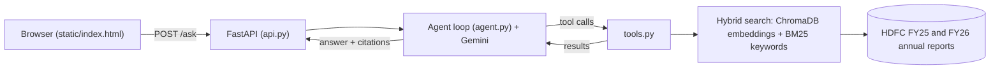

# Financial Filings Analyst Agent

An AI agent that answers questions about HDFC Bank's FY25 and FY26 annual reports. Every figure comes with the report and page it was found on, and the agent refuses to answer when the reports don't contain the answer.

**Live demo:** _add the link here after deployment_
**Demo video:** _add the link here_

## What it does

Ask a question such as "How did gross NPA change from FY25 to FY26, in percentage points and in percent?" The agent:

1. Looks up the figure for each year with a search tool.
2. Calculates the change with a calculator tool, so the language model never does arithmetic itself.
3. Answers with citations like `[HDFC FY26 p.248]`.

Questions it cannot answer from the reports (other banks, years outside FY25 and FY26, share prices) get a refusal, not a guess.

## Architecture



## How it works

| Step | What happens | File |
|---|---|---|
| Ingest | PDF text is split into chunks of about 1,500 characters at line boundaries, each tagged with source and page | `ingest.py` |
| Index | Chunks are embedded locally (all-MiniLM-L6-v2) and stored in ChromaDB | `build_index.py` |
| Retrieve | Meaning-based search and BM25 keyword search are merged with reciprocal rank fusion | `search.py` |
| Tools | `search_reports`, `compare_years`, `percent_change`, `difference`, `thousands_to_crore` | `tools.py` |
| Agent | A loop: the model asks for a tool, the code runs it, the result goes back to the model | `agent.py` |
| API and UI | FastAPI endpoint and a static HTML page | `api.py`, `static/index.html` |
| Evaluation | A question set with known answers, scored automatically | `evaluate.py`, `test_set.json` |

## Evaluation

The test set has questions with answers taken from the reports, plus questions that must be refused. Run:

```
python evaluate.py                # agent
python evaluate.py rag            # plain RAG baseline
python evaluate.py rescore agent  # re-score saved answers without calling the model
```

Citation validity checks that a cited page really contains the figure. For calculated answers (a change in percentage points or percent), the result is not printed anywhere, so the test set lists the input figures under `cite_values` and each one must appear on a cited page.

| System (17-question set) | Answer accuracy | Citation valid | Notes |
|---|---|---|---|
| Plain RAG, hybrid search | 14/17 | 12/13 | Misses total advances; does the NPA change arithmetic itself and gets it wrong |
| Agent | 17/17 | 13/13 | |

How the score changed while building: semantic search only scored 8/10, adding keyword search brought it to 9/10. The test file was also corrected between those runs, so the early numbers are approximate. Scores vary slightly from run to run, so run the evaluation several times and report the typical value.

## Known limitations

- Covers two reports only (HDFC Bank FY25 and FY26).
- Some figures sit in infographic pages where text extraction is jumbled, which makes retrieval harder (total advances is the known example).
- Embeddings come from a small general-purpose local model that is weak on exact financial terms, which is why keyword search is added.
- Figures in the reports appear in thousands in some tables and in crore in others, and the agent has to keep the units straight.
- Always check important numbers against the cited page.

## Run it locally

1. `pip install -r requirements.txt`
2. Create a `.env` file with `GEMINI_API_KEY=your_key`.
3. Download the HDFC Bank FY25 and FY26 integrated annual reports from the bank's investor relations page and save them as `data/hdfc_fy25.pdf` and `data/hdfc_fy26.pdf`. The PDFs are not included in this repo.
4. `python build_index.py`
5. `uvicorn api:app --reload`, then open http://127.0.0.1:8000

## Deploy

The app is a single FastAPI service that also serves the HTML page, so it runs on any host that can run Python.
The built index (`chroma_db/`) is committed to the repo so the host does not need the PDFs.

On Render (free web service, no Docker needed):

- Runtime: Python 3
- Build command: `pip install -r requirements.txt`
- Start command: `uvicorn api:app --host 0.0.0.0 --port $PORT`
- Environment variable: `GEMINI_API_KEY` (set in the host's settings, never in the code)

The free tier sleeps after 15 minutes idle, so the first request after a pause can take about a minute.
If the index is missing, the app stops at startup with a message saying so.
A `Dockerfile` is also included (port 7860) for hosts that run containers.

## Tech stack

Python, Gemini API, ChromaDB, rank-bm25, FastAPI, uvicorn, plain HTML and JavaScript, Docker.
